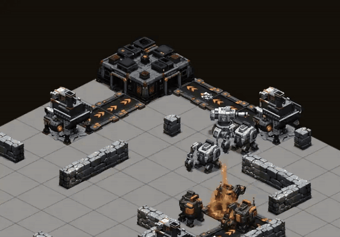
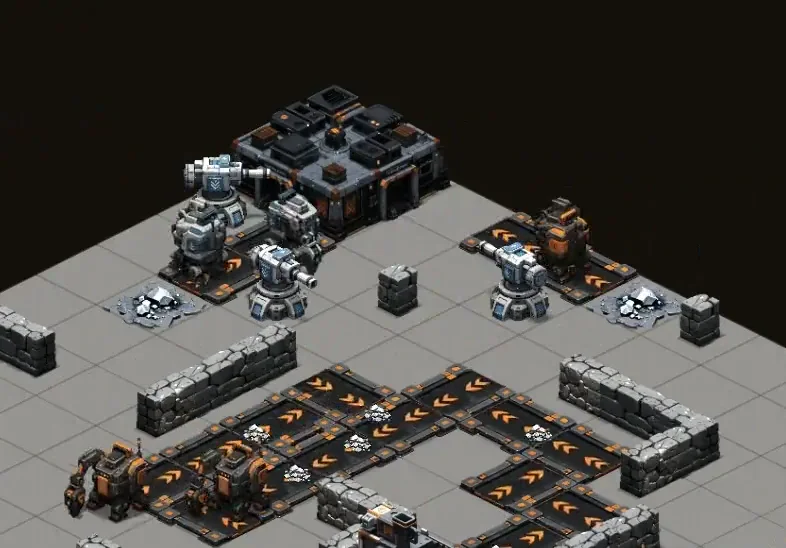
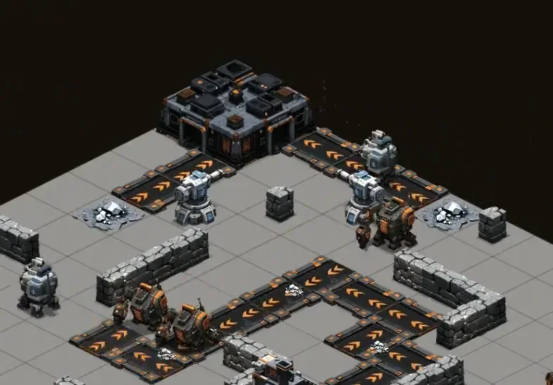
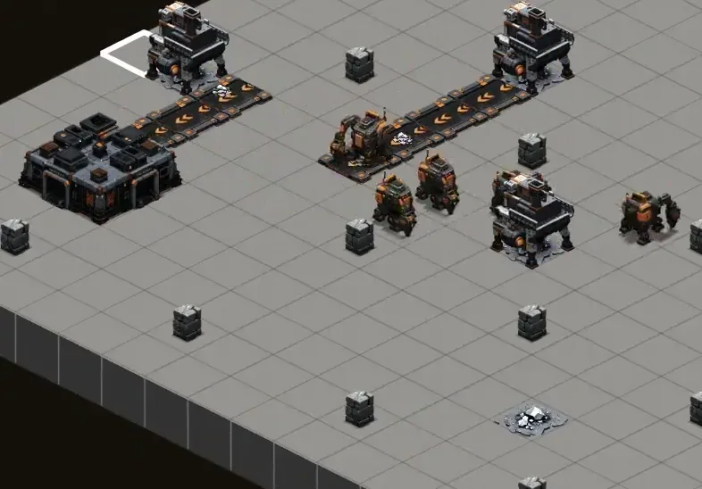
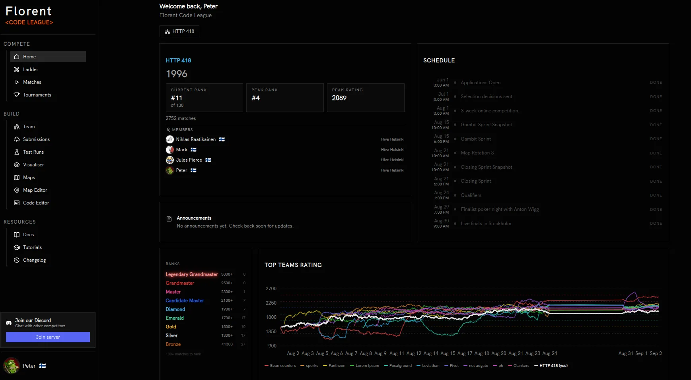

# teaPot: Team HTTP 418's Florent Code League bots

Python bots for [Florent's Code League](https://game.code.florent.vc/tutorials/), a Battlecode-style arena where two teams' bots fight over a grid map. Each side starts with a core and a few builders. Builders harvest titanium, lay conveyor belts to bring it home, and spend it on turrets and more units. The first side to destroy the other's core wins. If both survive to round 1000, titanium delivered decides it.

Team HTTP 418 finished in the top 10 of the combined Nordic and international ladder, peaked at rank 4, and was invited to the Stockholm finals. ([Team page](https://game.code.florent.vc/team/12fdece5-48c9-4913-9533-6d95b73e22ab))

<p align="center">
  
</p>

<table>
  <tr>
    <td></td>
    <td></td>
  </tr>
  <tr>
    <td align="center"><sub>Turrets on the flank facing the enemy core: the kill box that ended rushes</sub></td>
    <td align="center"><sub>Belts carrying harvested titanium home through a walled map</sub></td>
  </tr>
  <tr>
    <td></td>
    <td></td>
  </tr>
  <tr>
    <td align="center"><sub>Opening: builders fan out from the core to claim titanium</sub></td>
    <td align="center"><sub>Ladder dashboard over the season</sub></td>
  </tr>
</table>

## How the bot plays

Every unit runs its own `Player.run()` each turn with a 10 ms CPU budget and only sees a small radius around itself. The main ideas:

- **HiveMind.** Each team has a small shared store all of its units can read and write. Builders record what they discover (ore, walls, hostiles) there, so every unit works from the same map.
- **Map fingerprinting and A\*.** Every map in the live pool has unique dimensions, so the bot identifies the map on turn one and loads pre-parsed terrain. A\* pathing then runs without any exploration.
- **Roles.** The core spawns builders and gives each a role. Eco builders harvest and lay relay belts, a guardian holds home defence, and raiders siege the enemy core: they cut its belts, wall its ring and drop turrets beside enemy harvesters.
- **Anti-rush defence.** A rush always comes from the direction of the enemy core, so turrets go on the flanks facing it ahead of time. That builds a kill box every hostile builder has to walk through.
- **Hard CPU discipline.** Any search that could run long is capped by time, not by iteration count, so one slow path never costs a unit its turn.

`bots/count/` is the most recent bot. [`bots/count/AGENTS.md`](bots/count/AGENTS.md) has its module map, and `bots/count/docs/` holds design records and engine notes.

## Repository layout

| Path | What's there |
| --- | --- |
| [`bots/count/`](bots/count/) | The current bot: role-based builders, HiveMind store, A\* pathing, turret logic |
| [`bots/baron/`](bots/baron/), [`bots/bandit/`](bots/bandit/) | Earlier ladder bots that count grew out of |
| [`bots/starter/`](bots/starter/) | The official starter bot, used as the local baseline opponent |
| [`components/`](components/) | HiveMind and map-feature modules shared between bots |
| [`scripts/`](scripts/) | Local gauntlets, a replay debugger, ladder stats, and submission packaging |
| [`fcv_gauntlet/`](fcv_gauntlet/) | Replay analysis engine: behaviour detectors, causal chains, reports |
| [`graveyard/`](graveyard/) | Retired experiments, kept for reference |
| [`maps/`](maps/) | Map files for local play |
| [`STRATEGY.md`](STRATEGY.md) | Game rules and strategy notes |

## Setup

```bash
git clone git@github.com:slowTake/teaPot.git
cd teaPot

python3 -m venv .venv
source .venv/bin/activate
pip install fcode

fcode login
fcode starter   # if you don't already have bots/scaffolded
```

On Windows (PowerShell): `.venv\Scripts\Activate.ps1`

## Daily use

```bash
source .venv/bin/activate
fcode run starter starter
fcode watch replay.replay26   # replay name may differ
```

## Scripts

Local test runners live in `scripts/`. Install CI deps first:

```bash
source .venv/bin/activate
pip install -r requirements-ci.txt
```

`bot_gauntlet.py`, `extreme_gauntlet.py`, and `mirror_gauntlet.py` all default to your bot's **live map pool** — the `MAP_ID_TO_NAME` table in your bot's own `features.py`, not every file sitting in `maps/` (`maps/` accumulates maps your bot was never fingerprinted for and has no ORE/WALL data for; testing against those runs your bot in a materially different, non-competitive mode). Pass `--maps` to override with a specific subset.

Each gauntlet match prints:

| Column | Meaning |
| --- | --- |
| Map | Map name (`extreme_gauntlet` appends `-1` … `-5` per run) |
| Result | `WIN` or `LOSS` for your bot |
| Condition | How the game ended (e.g. `Core destroyed`, `Titanium collected`) |
| Ally Ti | Titanium your bot delivered to its core |
| Enemy Ti | Titanium `starter` delivered to its core |
| Turn | Final turn count |

Optional: limit to specific maps with `--maps sprint strait` (any map file in `maps/`, live pool or not — an explicit `--maps` always wins).

### `bot_gauntlet.py`

Runs your bot against `starter` on your live map pool, once each. Passes only on **15/15 wins** (same bar as CI). `--tle <ms>` matches the server's real per-turn time limit (default 10ms, `--tle 0` disables it).

```bash
python scripts/bot_gauntlet.py --bot <your-bot>
python scripts/bot_gauntlet.py --bot turtle --maps sprint strait
```

### `extreme_gauntlet.py`

Runs your bot against `starter` on your live map pool, **5 times each** with different seeds (`base`, `base+1`, …). Reports total wins and win rate, plus a per-map win/loss letter grid. Passes only if every match is won.

```bash
python scripts/extreme_gauntlet.py --bot <your-bot>
python scripts/extreme_gauntlet.py --bot turtle --maps sprint
```

Example footer:

```
Total: 12/15
Win rate: 80.0%

=== Per map (one letter per run, seeds 1..5) ===
  sprint       WWWWW
  strait       WWLWW
```

### `mirror_gauntlet.py`

Runs your bot **against itself** on your live map pool. There's no win/loss to grade — both sides are the same bot — so instead it catches:

- **Crashes** — a Python exception inside your bot, surfaced from the replay's captured stdout even when the match completes normally (the engine swallows per-unit exceptions, so a crash never shows up as a bad exit code).
- **Side imbalance** — anything but a roughly even outcome on a symmetric map points at a real bug, not matchup luck. Reported, not graded pass/fail.

```bash
python scripts/mirror_gauntlet.py --bot <your-bot>
python scripts/mirror_gauntlet.py --bot turtle --maps sprint strait   # faster subset
```

### `replay_debugger.py`

Reconstructs full game state from a `.replay26` file at any round, and can re-run your bot's `Player.run()` against a mock `Controller` backed by that state — reproduce a tournament bug locally, with your own debug prints, even without the opponent's code.

```bash
# Summarize world state + entities at round 150
python scripts/replay_debugger.py replay.replay26 -r 150 --dump --list-entities

# Re-run a specific unit's logic (defaults to --bot count)
python scripts/replay_debugger.py replay.replay26 -r 150 -u 7 -t A --bot <your-bot>

# Same, but first rebuild the communication store by replaying from round 0
python scripts/replay_debugger.py replay.replay26 -r 150 -u 7 -t A --rebuild-store
```

Limitations: store slots (0–15) aren't in the replay — `--rebuild-store` reconstructs them by re-running your bot from round 0, which is slow. Actions are logged but don't mutate state (single-step, read-only). Run with `-h` for the full flag list and more workflows (TLE investigation, pathfinding debugging).

### `zip_bot.py`

Packages a bot for league submission. Starting from `main.py`, it follows local imports and zips only the modules your bot actually loads — docs, replays, `__pycache__`, and unreachable modules are left out. Files land at the zip root (`main.py` must be the entry point), and re-running replaces any existing zip for that bot.

```bash
python scripts/zip_bot.py baron
python scripts/zip_bot.py baron -n              # dry run: list files, don't write
python scripts/zip_bot.py baron -o dist/         # write elsewhere (default: repo root)
python scripts/zip_bot.py baron --all            # every .py in the bot dir, not just imported
python scripts/zip_bot.py baron --include data.json   # add an extra file (repeatable)
```

Prints the file list and total size before writing, and (unless `--all`) which `.py` files in the bot dir were skipped as unimported — useful for catching a module you meant to wire in but forgot to import.

### `fcv_bot_gauntlet.py`

Diagnostic engine for replay analysis — behavioral detectors (crashes, orphan harvesters, friendly fire, oscillation, ...), causal event chains, cost-weighted "top Ti leaks," and JSON/CSV/Markdown reports. Lives in [`fcv_gauntlet/`](fcv_gauntlet/).

**Needs the `fcv` package**, which isn't on PyPI — install it separately, once per venv:

```bash
git clone https://github.com/DataAthleteChamp/florent-code-visualiser.git
pip install -e florent-code-visualiser/
```

Without it, `fcv_bot_gauntlet.py` fails immediately with `ModuleNotFoundError: No module named 'fcv'`.

```bash
# Analyze a single existing replay
python scripts/fcv_bot_gauntlet.py --replay replay.replay26 --markdown-report /tmp/report.md

# Full gauntlet with JSON/CSV output
python scripts/fcv_bot_gauntlet.py <your-bot> starter --all-maps --json-output report.json --csv-metrics metrics.csv
```

Optional AI root-cause diagnosis (`--oracle`) uses the Claude API and **costs real money from a personal API budget** — it never spends without an explicit `--oracle-yes` on top of `--oracle`. See [`fcv_gauntlet/oracle/README.md`](fcv_gauntlet/oracle/README.md) for setup and budget caps, and [`fcv_gauntlet/oracle/AGENT.md`](fcv_gauntlet/oracle/AGENT.md) for the confirmation rule any agent must follow before using it.

### Live ladder analysis

For checking how the submitted bot is actually doing on the real overnight ladder (not local gauntlet runs):

- `scripts/get_stats.py` — ladder rank/rating plus a `<bot>_performance.md` win-rate report by map/opponent/version.
- `scripts/create_db.py` — downloads recent ladder replays and samples build/economy state into `scripts/match_observations.csv` for cross-map/opponent comparison.

## CI bot test

When your bot is ready, commit it under `bots/<your-bot>/main.py` and open a PR.

CI runs `bot_gauntlet.py` automatically on changed bots. The check passes only on **15/15 wins**.

Run the same test locally before pushing — see [`bot_gauntlet.py`](#bot_gauntletpy) above.

## Notes

- Do not commit `.venv/` — each person creates their own.
- Strategy notes: [`STRATEGY.md`](STRATEGY.md)
- Shared bot helpers: [`florent_lib.py`](florent_lib.py) (copy into `main.py` before league upload if needed)
