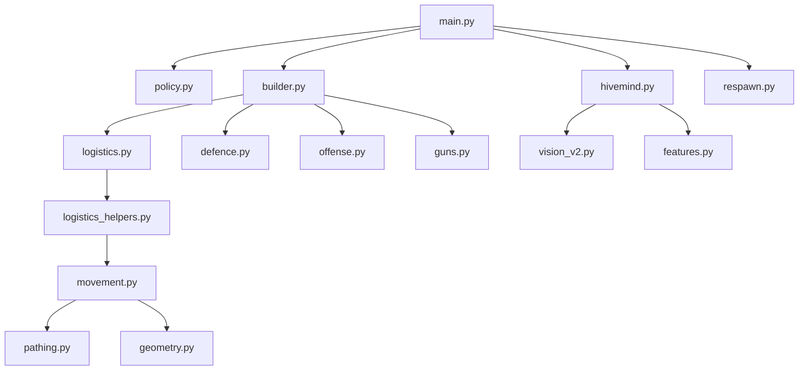
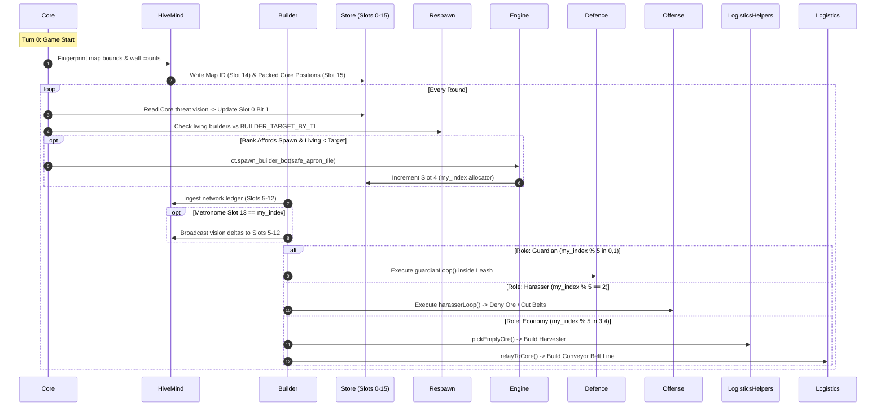

# Baron Bot Architecture & Operations Specification (`baron.md`)

This document provides a comprehensive, file-by-file specification and operational guide for **Baron**, an autonomous real-time strategy (RTS) bot engineered for the `fcode` game engine.

---

## 1. Executive Summary & Design Philosophy

Baron is a **decentralized multi-unit bot** designed for performance, resilience, and adaptability. In the `fcode` engine, each unit (Core, Builder Bot, Gunner, Sentinel) executes its own turn independently via a shared Python codebase. 

Baron achieves macro-level strategic coordination without centralized overhead by utilizing:
1. **Shared Store IPC (Slots 0–15)**: Compact bit-packed integer communication leveraging the 16 global memory slots provided by the engine controller.
2. **Deterministic Role Allocation (`my_index`)**: Builder units claim a unique monotonic index at birth and assign themselves roles (`Guardian`, `Economy Builder`, `Harasser`) via deterministic modular arithmetic (`my_index % 5`).
3. **Proof-Verified Economic Relays**: A* pathfinding constructs conveyor supply lines connecting Harvesters to the Core. Relays require "proof by vision" or connected existing belts before construction.
4. **Dynamic Leash Systems**: Units maintain a tight home defense leash when threats are detected near the Core, automatically widening to an expansion leash when safe.
5. **Hyperparameter Externalization (`policy.py`)**: All tuning constants are isolated in a leaf module (`policy.py`), allowing automated Optuna hyperparameter optimization without modifying structural logic.

---

## 2. Store Slot Inter-Process Communication (IPC) Protocol

The engine provides 16 integer slots (`read_store(slot)`, `write_store(slot, val)`). Baron structures global shared memory as follows:

| Slot | Identifier | Purpose & Bit Format |
|---|---|---|
| **0** | `SLOT_RELAY_COMPLETE` | **Bit-packed status & heartbeat slot**:  • Bit 0: Relay completion flag (written by builders) • Bit 1: `CORE_THREAT_BIT` (set by Core when enemy turret/builder seen within Chebyshev 6) • Bits 2–11: Guardian 1 last-active round heartbeat • Bits 12–21: Guardian 2 last-active round heartbeat |
| **1–3** | `SLOT_ORPHAN_1..3` | **Orphaned Harvester Registry**: Stores positions `(x, y)` of built Harvesters whose relay line was broken or never finished, allowing idle builders to claim and connect them. |
| **4** | `SLOT_BUILDER_COUNT` | **Monotonic Builder Index Allocator**: Total builders ever spawned. Monotonically increasing; each new builder reads this slot to claim its `my_index`. |
| **5–12**| `SLOT_LEDGER_0..7` | **16-Delta Network Broadcast Window**: 8 slots storing bit-packed tile/entity sightings (2 deltas per slot packed via `vision_v2.py`) for shared team fog-of-war vision. |
| **13** | `SLOT_METRONOME` | **Round-Robin Broadcast Metronome**: Controls which builder index is allowed to broadcast its vision to Slots 5–12 on the current tick. |
| **14** | `SLOT_MAP_ID` | **Map Identification Index**: Set by the Core on turn 0 after fingerprinting the map layout against `KNOWN_MAPS` in `features.py`. |
| **15** | `SLOT_PACKED_CORES` | **Packed Ally & Enemy Core Positions**: Stores encoded `(x, y)` and status states (`KNOWN`, `ASSUMED`, `UNKNOWN`) for both cores. |

---

## 3. Comprehensive File-by-File Breakdown

Below is the detailed breakdown of every file in the Baron bot codebase (`bots/baron/`), covering its role, major classes, and key functions.

---

### 3.1 `main.py` — Entrypoint & Execution Dispatcher

- **Role**: Primary entrypoint loaded by the engine. Defines the `Player` class and routes execution per tick per active unit type.
- **Key Components**:
  - `Player` Class: Instantiates unit-level state memory (`hivemind`, `respawn`, `offense`, `guardian`, movement caches, stuck counters).
  - `run(self, ct: Controller)`: Dispatcher method called every round.
    - **Core Unit (`EntityType.CORE`)**: Triggers `hivemind.tick(ct)`, scans for threats, updates `CORE_THREAT_BIT` in Store Slot 0, and calls `respawn.run_core_spawn()`.
    - **Builder Bot (`EntityType.BUILDER_BOT`)**: Triggers `hivemind.tick(ct)`, updates oscillation/stuck history, and calls `builder.runBuilderRoles(self, ct)`.
    - **Gunner / Sentinel**: Dispatches to `guns.gunnerLoop()` or `guns.sentinelLoop()`.

---

### 3.2 `policy.py` — Hyperparameters & Tuning Registry

- **Role**: Leaf module containing all strategy knobs, threshold constants, and bit-mask definitions. Imported at top-level by all modules.
- **Key Parameters**:
  - `MAX_BUILDERS_EARLY`: Unpaced early rush cap (default: 4–5).
  - `MAX_BUILDERS`: Hard ceiling on total living builder crew (default: 10–12).
  - `BUILDER_TARGET_BY_TI`: Crew target scaling table by Titanium bank balance (e.g. `[(2000, 10), (1000, 7)]`).
  - `BUILDER_GROWTH_DELAY_TURNS`: Rounds before crew growth past early rush cap is permitted.
  - `MAX_GUARDIANS`: Maximum builders assigned to home defensive patrol (default: 2–4).
  - `GUARDIAN_LEASH_WIDE` / `GUARDIAN_LEASH_TIGHT`: Chebyshev radii from Core determining guardian movement bounds during peace (wide, e.g. 6) vs threat (tight, e.g. 3).
  - `WAVE_ATTACK_TI` / `WAVE_ATTACK_TURN`: Triggers transitioning builders into aggressive enemy core pushes.

---

### 3.3 `builder.py` — Dynamic Builder Dispatcher & Role Loop

- **Role**: Top-level builder control loop. Manages role assignments, stuck/encirclement recovery, and fallback action chains.
- **Key Functions**:
  - `runBuilderRoles(bot, ct)`: Evaluates unit priority chain every turn:
    1. **Emergency Core Healing**: Cardinally adjacent builders repair damaged Core.
    2. **Orphan Recovery & Ore Check**: Build/extend harvesters and conveyor lines.
    3. **Encirclement / Stuck Recovery**: Demolish obstacles if trapped (`breakEncirclement`).
    4. **Role Allocation**:
       - `guardianRank(bot)` $\le \text{MAX\_GUARDIANS}$: Route to `defence.guardianLoop()`.
       - `harasserRank(bot)`: Route to `offense.harasserLoop()`.
       - Default: Route to `logistics_helpers.checkOre()` (Economy Expansion).

---

### 3.4 `logistics.py` — Conveyor Relays & Belt Mechanics

- **Role**: Core economic pipeline module handling conveyor belt pathfinding, facing verification, extension, and enemy belt cutting.
- **Key Functions**:
  - `relayToCore(bot, ct, ore_pos)`: Constructs an A* conveyor path from `ore_pos` back to the Core footprint or an existing active ally belt.
  - `_relayPassable(ct, pos, local_map)`: Custom passability evaluator ensuring belts do not loop or block existing infrastructure.
  - `_tryExtendThroughMerge(bot, ct)`: Merges new harvester belts into existing active supply lines within `RELAY_MERGE_MAX_HOPS`.
  - `cutEnemyBelts(bot, ct)`: Harassment function to step adjacent to hostile conveyors and demolish them.

---

### 3.5 `logistics_helpers.py` — Ore Economy & Apron Maintenance

- **Role**: Resource node evaluation, Harvester placement, and Core apron belt upkeep.
- **Key Functions**:
  - `pickEmptyOre(bot, ct)`: Finds the optimal unclaimed ore deposit evaluated by Manhattan distance to Core, density, and safety from enemy gunner fire.
  - `maintainApron(bot, ct)`: Inspects the 8 cardinal tiles touching the 2x2 Core footprint and repairs missing or damaged conveyor belt connections.
  - `checkOre(bot, ct)`: Orchestrates the builder workflow: walk to chosen ore $\rightarrow$ build Harvester $\rightarrow$ trigger `logistics.relayToCore()`.

---

### 3.6 `defence.py` — Home Defense & Leash Patrol

- **Role**: Manages defensive guardian bots, perimeter patrols, and counter-turret construction.
- **Key Functions**:
  - `guardianLoop(bot, ct)`: Control loop for guardian-assigned builders.
  - `moveTowardLeash(bot, ct, target, core_pos, radius)`: Moves toward `target` while strictly constraining all steps to remain within Chebyshev distance `radius` of `core_pos`.
  - `_reactEnemyTurret(bot, ct)`: Scans for enemy turrets threatening the Core apron and deploys counter-Gunners or Sentinels.

---

### 3.7 `offense.py` — Harassment, Ore Denial & Core Push

- **Role**: Disrupting opponent economy and executing offensive pushes.
- **Key Functions**:
  - `harasserLoop(bot, ct)`: Control loop for harasser-assigned builders.
  - `denyOre(bot, ct)`: Advances into enemy territory and builds barriers over unclaimed ore nodes in the enemy's expansion zone.
  - `waveAttack(bot, ct)`: Marches builders toward the enemy Core footprint to construct offensive Gunners once economic or turn thresholds are reached.

---

### 3.8 `guns.py` — Stationary Turret Lifecycle

- **Role**: Controls spawned Gunner and Sentinel structures.
- **Key Functions**:
  - `gunnerLoop(ct)` / `sentinelLoop(ct)`: Executes target selection, firing logic, ammo level management, and idle self-destruct timers (`GUNNER_IDLE_TURNS`).

---

### 3.9 `movement.py` — Navigation & Path Execution

- **Role**: High-level movement abstraction built on top of `pathing.py`.
- **Key Functions**:
  - `moveToward(bot, ct, target)`: Computes an A* path to `target` and executes single-step movement (`ct.move()`), handling step-off from self-tiles and temporary obstruction caching.
  - `clearRoute(bot, ct, target)`: Demolishes minor friendly/enemy obstacles blocking a path if no alternative route exists.

---

### 3.10 `pathing.py` — Grid Search Algorithms

- **Role**: Low-level A* graph search implementations.
- **Key Functions**:
  - `astar(start, is_passable, is_goal, max_iters)`: General-purpose A* implementation.
  - `astarFromSeeds(seeds, is_passable, is_goal, max_iters)`: Multi-source A* search used for region matching.

---

### 3.11 `geometry.py` — Footprint & Spatial Math

- **Role**: Spatial calculations, footprint memoization, and distance metrics.
- **Key Functions**:
  - `coreFootprint(core_pos)`: Returns the 4 `Position` tiles `[(x,y), (x+1,y), (x,y+1), (x+1,y+1)]` forming the 2x2 Core structure.
  - `chebyshevToCore(pos, core_pos)` / `manhattanToCore(pos, core_pos)`: Calculates exact distance from `pos` to the nearest tile of the 2x2 Core footprint.

---

### 3.12 `respawn.py` — Core Builder Spawning

- **Role**: Evaluates Core builder spawning conditions and safe exit tiles.
- **Key Functions**:
  - `run_core_spawn(ct, schedule, goal, hivemind)`: Checks living builder counts against `BUILDER_TARGET_BY_TI`, verifies affordability, and spawns new builder bots into safe apron tiles.

---

### 3.13 `hivemind.py` — Shared Map State & Fog-of-War Synchronization

- **Role**: Local map data structure and network IPC ledger.
- **Key Class**: `HiveMind`
  - `local_map`: Multi-unit merged dictionary mapping `(x, y)` coordinates to tile terrain, ore status, building types, and entity teams.
  - `_broadcast_ledger(ct)` / `_sync_ledger(ct)`: Transmits and ingests 16-delta vision packages over Store Slots 5–12 using round-robin slot 13 timing.

---

### 3.14 `features.py` — Map Fingerprint Registry

- **Role**: Pre-baked map metadata and symmetry definitions for competitive ladder maps.
- **Key Contents**:
  - `KNOWN_MAPS`: Dictionary mapping initial map fingerprints `(width, height, team, core_x, core_y, wall_count)` to map IDs, names, and enemy core positions.

---

### 3.15 `walls.py` — Perimeter Fortification

- **Role**: Core wall and barrier placement routines to seal defensive gaps.

---

### 3.16 `vision_v2.py` — Binary Ledger Wire Format

- **Role**: Low-level bit-packing routines (`pack_ledger_slot`, `unpack_ledger_slot`) compressing entity positions, directions, types, and teams into Store integers.

---

## 4. End-to-End Operational Lifecycle Walkthrough

---

## 5. Summary Table of Key Bot Functions

| Function Name | Location File | Purpose |
|---|---|---|
| `run(ct)` | [`main.py`](file:///home/markb/florent_league/teaPot/bots/baron/main.py) | Primary engine tick dispatcher per unit |
| `runBuilderRoles(bot, ct)` | [`builder.py`](file:///home/markb/florent_league/teaPot/bots/baron/builder.py) | Priority-based builder task evaluator |
| `relayToCore(bot, ct, ore)` | [`logistics.py`](file:///home/markb/florent_league/teaPot/bots/baron/logistics.py) | A* conveyor belt path construction |
| `pickEmptyOre(bot, ct)` | [`logistics_helpers.py`](file:///home/markb/florent_league/teaPot/bots/baron/logistics_helpers.py) | Dynamic resource node selection |
| `maintainApron(bot, ct)` | [`logistics_helpers.py`](file:///home/markb/florent_league/teaPot/bots/baron/logistics_helpers.py) | Core 2x2 apron belt maintenance |
| `guardianLoop(bot, ct)` | [`defence.py`](file:///home/markb/florent_league/teaPot/bots/baron/defence.py) | Home perimeter defense patrol |
| `harasserLoop(bot, ct)` | [`offense.py`](file:///home/markb/florent_league/teaPot/bots/baron/offense.py) | Opponent ore denial & belt cutting |
| `gunnerLoop(ct)` | [`guns.py`](file:///home/markb/florent_league/teaPot/bots/baron/guns.py) | Stationary turret targeting & ammo |
| `moveToward(bot, ct, target)` | [`movement.py`](file:///home/markb/florent_league/teaPot/bots/baron/movement.py) | High-level pathing navigation |
| `astar(start, ...)` | [`pathing.py`](file:///home/markb/florent_league/teaPot/bots/baron/pathing.py) | Core grid pathfinding search |
| `run_core_spawn(...)` | [`respawn.py`](file:///home/markb/florent_league/teaPot/bots/baron/respawn.py) | Core builder production scheduler |
| `tick(ct)` | [`hivemind.py`](file:///home/markb/florent_league/teaPot/bots/baron/hivemind.py) | Fog-of-war map & ledger sync |
